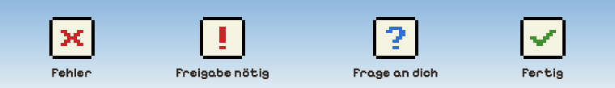
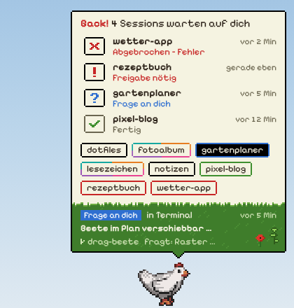
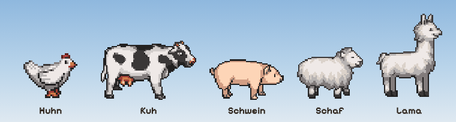

<div align="center">

# 🐔 Farmies

**Ein kleines Pixel-Tier am Bildschirmrand, das dir Bescheid gibt,<br>wenn Claude Code auf dich wartet.**


[](https://github.com/gustganz/farmies/releases/latest)


### [⬇️ Herunterladen](https://github.com/gustganz/farmies/releases/latest)

</div>

## Installieren

> Voraussetzung: [Claude Code](https://code.claude.com/docs) ist installiert
> (unter Windows in **WSL**).

**🪟 Windows**

1. Auf der [Download-Seite](https://github.com/gustganz/farmies/releases/latest) die Datei
   **`Farmies-…-portable.exe`** laden.
2. An einen festen Platz legen (z. B. *Dokumente*) und doppelklicken. Fertig.

<sub>Falls Windows „Der Computer wurde durch Windows geschützt“ meldet: *Weitere Informationen* → *Trotzdem ausführen*.</sub>

**🍎 macOS**

1. Auf der [Download-Seite](https://github.com/gustganz/farmies/releases/latest) die passende ZIP laden:
   **`…-mac-arm64.zip`** (Apple Silicon, M1 und neuer) oder **`…-mac-x64.zip`** (Intel).
2. Entpacken und **Farmies** in *Programme* ziehen.
3. Einmalig im Terminal freischalten (die App ist nicht notarisiert):

   ```sh
   xattr -cr /Applications/Farmies.app && codesign --force --deep -s - /Applications/Farmies.app
   ```

4. Farmies öffnen.

Das war's. Farmies richtet sich beim Start selbst ein, startet ab jetzt mit dem Rechner und
**aktualisiert sich von selbst**. Laufende Claude-Sessions bei Bedarf einmal neu starten.

## Was das Tier dir sagt

<p align="center"></p>

Arbeitet Claude noch, läuft das Tier herum. Wartet etwas auf dich, hüpft es mit Sprechblasen.
Ist nichts los, legt es sich schlafen. 💤

## Alle Sessions auf einen Blick



**Maus übers Tier:** alle Sessions mit ihrem Zustand. Unten auf der Wiese steht, woran die Session
gerade arbeitet.

**Klick** auf eine Blase oder Session holt genau dieses Fenster nach vorne, auch den richtigen Tab in
Windows Terminal oder das Terminal in VS Code und Cursor.

**Packen und fallen lassen:** Das Tier lässt sich mit der Maus herumtragen, auch auf einen anderen
Bildschirm.

**Rechtsklick** aufs Tier: Tier wählen, Größe, ausblenden, beenden.

Die Wiese ändert sich jeden Monat, und ab und zu schaut ein kleiner Besucher vorbei. 🐞

<br clear="right">

## Such dir dein Tier aus

<p align="center"></p>

## Gut zu wissen

- 🔒 Alles bleibt auf deinem Rechner. Farmies schickt nichts ins Internet, es schaut nur nach Updates.
- 🧹 **Entfernen:** Rechtsklick aufs Tier → *Deinstallieren…* entfernt Hooks und Autostart, danach die
  App löschen.
- 🛠️ Mitentwickeln: [docs/entwicklung.md](docs/entwicklung.md)

<sub>Tiere: „LPC style farm animals“ von Daniel Eddeland,
[CC-BY 3.0](https://creativecommons.org/licenses/by/3.0/)
([OpenGameArt](https://opengameart.org/content/lpc-style-farm-animals)).
Schriften: Pixelify Sans und Silkscreen (OFL). Details: [assets/CREDITS.md](assets/CREDITS.md).</sub>
